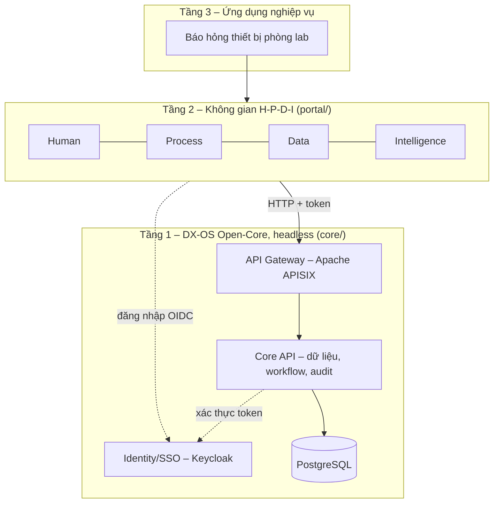

<!--
SPDX-FileCopyrightText: 2026 DX-Lab contributors

SPDX-License-Identifier: CC-BY-4.0
-->

# DX-Lab

**Trạm điều hành số trên nền tảng DX-OS Open-Core, áp dụng cho bài toán báo hỏng và xử lý sự cố
thiết bị phòng thực hành tại Đại học Công nghiệp Hà Nội (HaUI).**

[](LICENSE)
[](LICENSES/CC-BY-4.0.txt)
[](https://reuse.software/spec-3.3/)

Sản phẩm dự thi của đội **HaUI.NPC**, khối Phần mềm nguồn mở OLP 2026, chủ đề
[DX-OS Open-Core](https://vfossa.vn/tin-tuc/de-thi-phan-mem-nguon-mo-olp-2026-798.html).

> **Trạng thái:** đang phát triển, **chưa phát hành phần mềm chạy được**. Kiến trúc dưới đây là
> thiết kế mục tiêu; bảng [Trạng thái](#trạng-thái) ghi đúng những gì đã có.

## Bài toán

Sinh viên và giảng viên phát hiện thiết bị phòng lab hỏng (máy tính, máy chiếu, mạng, điều hòa)
nhưng thường báo qua tin nhắn hoặc lời nói. Yêu cầu dễ thất lạc, không ai theo dõi được ai đang
xử lý, bao lâu thì xong, và tri thức sửa chữa nằm trong đầu một vài cán bộ kỹ thuật.

DX-Lab số hóa một quy trình đầu-cuối: **báo hỏng → phân loại và ưu tiên → xử lý → phê duyệt
(khi vượt ngưỡng chi phí) → nghiệm thu**, với lịch sử thay đổi đầy đủ.

## Kiến trúc 3 tầng



Nguyên tắc: Tầng 1 không phục vụ giao diện và không biết ứng dụng nào đang gọi. Thêm một quy
trình nghiệp vụ mới là khai báo định nghĩa quy trình cho Core, không sửa mã Core.

| Không gian | Năng lực trong DX-Lab |
|---|---|
| H – Human | Đăng nhập SSO, vai trò (người báo hỏng, kỹ thuật viên, trưởng lab, quản trị), kho hướng dẫn sửa chữa |
| P – Process | Quy trình có trạng thái, người tạo, người xử lý, thời hạn, lịch sử; danh sách việc chờ xử lý |
| D – Data | Nguồn dữ liệu thống nhất, provenance, tìm kiếm/lọc/thống kê, dashboard, REST API có OpenAPI |
| I – Intelligence | Phân loại và đề xuất mức ưu tiên có giải thích; hỏi đáp hướng dẫn sửa chữa có trích dẫn |

## Thành phần

| Thành phần | Vai trò | Giấy phép | Trạng thái |
|---|---|---|---|
| [FastAPI](https://fastapi.tiangolo.com/) | Core API (Tầng 1), máy chủ portal | MIT | Đã khai báo |
| [SQLAlchemy](https://www.sqlalchemy.org/) | Truy cập dữ liệu của Core | MIT | Đã khai báo |
| [Prefab](https://github.com/PrefectHQ/prefab) `prefab-ui==0.21.1` | Giao diện H-P-D-I viết bằng Python | Apache-2.0 | Đã khai báo |
| [PostgreSQL](https://www.postgresql.org/) | Dữ liệu cấu trúc | PostgreSQL License | Dự kiến |
| [Keycloak](https://www.keycloak.org/) | Identity, SSO, RBAC | Apache-2.0 | Dự kiến |
| [Apache APISIX](https://apisix.apache.org/) | API Gateway | Apache-2.0 | Dự kiến |

Bảng đầy đủ kèm phiên bản và nguồn gốc của từng phụ thuộc sẽ có cùng bản phát hành đầu tiên.

## Trạng thái

| Hạng mục | Trạng thái |
|---|---|
| Khung nguồn mở: giấy phép, REUSE, CI, CONTRIBUTING, SECURITY, mẫu issue | Có |
| Workspace `core/` + `portal/`, build được từ mã nguồn | Có |
| Tầng 1: Keycloak, APISIX, Core API, workflow | Chưa |
| Tầng 2/3: portal H-P-D-I, ứng dụng báo hỏng | Chưa |
| Docker Compose, dữ liệu mẫu, tài khoản demo | Chưa |

## Cấu trúc thư mục

```text
core/      Gói dxlab-core: Open-Core headless (Tầng 1)
portal/    Gói dxlab-portal: giao diện H-P-D-I và ứng dụng (Tầng 2/3)
LICENSES/  Toàn văn các giấy phép đang dùng trong repo
.github/   CI và mẫu báo lỗi
.agents/   Skill hỗ trợ phát triển cho trợ lý lập trình
```

`portal` không phụ thuộc `core` ở mức gói: hai bên chỉ giao tiếp qua HTTP tại API Gateway.

## Cài đặt từ mã nguồn

Yêu cầu: Python >= 3.12, [uv](https://docs.astral.sh/uv/), `git`. Toàn bộ là công cụ nguồn mở.

```bash
git clone https://github.com/HaUI-NPC/dx-lab.git
cd dx-lab
uv sync --all-packages
```

Kiểm tra build và tuân thủ giấy phép cấp tệp:

```bash
uv build --all-packages
uvx reuse lint
```

## Giấy phép

| Tài sản | Giấy phép |
|---|---|
| Mã nguồn | [Apache-2.0](LICENSE), giấy phép được [OSI phê duyệt](https://opensource.org/license/apache-2.0) |
| Tài liệu (`README`, `CHANGELOG`, `CONTRIBUTING`…) | [CC BY 4.0](LICENSES/CC-BY-4.0.txt) |
| Dữ liệu bên thứ ba | Giữ nguyên giấy phép gốc, ghi nguồn và quyền sử dụng cho từng tập |

Mỗi tệp khai báo bản quyền và giấy phép theo [REUSE 3.3](https://reuse.software/spec-3.3/), bằng
SPDX header trong tệp hoặc qua [`REUSE.toml`](REUSE.toml).

## Đóng góp, quản trị và báo lỗi

- Quy trình đóng góp, yêu cầu ký nhận DCO: [`CONTRIBUTING.md`](CONTRIBUTING.md)
- Quy tắc ứng xử: [`CODE_OF_CONDUCT.md`](CODE_OF_CONDUCT.md)
- Người phụ trách và phân quyền: [`MAINTAINERS.md`](MAINTAINERS.md)
- Báo lỗi, đề xuất: [issue tracker](https://github.com/HaUI-NPC/dx-lab/issues)
- Báo lỗ hổng bảo mật: [`SECURITY.md`](SECURITY.md), **không** mở issue công khai
