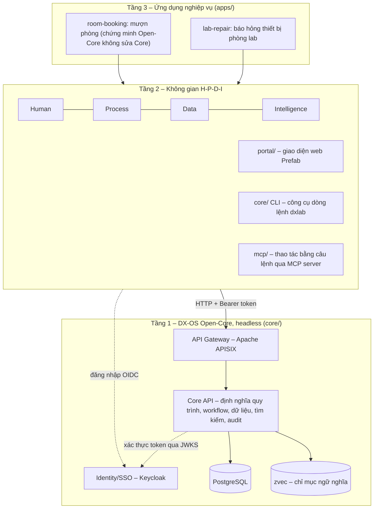

<!--
SPDX-FileCopyrightText: 2026 DX-Lab contributors

SPDX-License-Identifier: CC-BY-4.0
-->

# DX-Lab

**Trạm điều hành số trên nền tảng DX-OS Open-Core, áp dụng cho bài toán báo hỏng và xử lý sự cố thiết bị phòng thực hành tại Đại học Công nghiệp Hà Nội (HaUI).**

[](LICENSE)
[](LICENSES/CC-BY-4.0.txt)
[](https://reuse.software/spec-3.3/)

Sản phẩm dự thi của đội **HaUI.NPC**, khối Phần mềm nguồn mở OLP 2026, chủ đề [DX-OS Open-Core](https://vfossa.vn/tin-tuc/de-thi-phan-mem-nguon-mo-olp-2026-798.html).

> **Trạng thái:** Bản **0.2.2** chạy được đầu-cuối trên một máy bằng Docker Compose với dữ liệu và tài khoản demo (tên giả, hạn mức giả định). Bảng [Trạng thái](#trạng-thái) ghi đúng những gì đã có và phần [Lộ trình](#lộ-trình-sau-cuộc-thi) ghi các tính năng phát triển tiếp theo.

---

## Mục lục

1. [Bài toán](#bài-toán)
2. [Kiến trúc 3 tầng & Không gian H-P-D-I](#kiến-trúc-3-tầng--không-gian-h-p-d-i)
3. [Thành phần công nghệ](#thành-phần-công-nghệ)
4. [Trạng thái](#trạng-thái)
5. [Cấu trúc thư mục](#cấu-trúc-thư-mục)
6. [Cấu hình](#cấu-hình)
7. [Cài đặt & Khởi động](#cài-đặt--khởi-động)
   - [Cách 1: Chạy bằng Docker Compose (Khuyên dùng)](#cách-1-chạy-bằng-docker-compose-khuyên-dùng)
   - [Cách 2: Cài đặt từ mã nguồn](#cách-2-cài-đặt-từ-mã-nguồn)
8. [Tài khoản demo & Xác thực hai bước](#tài-khoản-demo--xác-thực-hai-bước)
9. [Kịch bản kiểm thử E2E tự động](#kịch-bản-kiểm-thử-e2e-tự-động)
10. [Công cụ dòng lệnh CLI `dxlab` & MCP Server](#công-cụ-dòng-lệnh-cli-dxlab--mcp-server)
11. [Core API qua Gateway](#core-api-qua-gateway)
12. [Lộ trình sau cuộc thi](#lộ-trình-sau-cuộc-thi)
13. [Giấy phép](#giấy-phép)
14. [Đóng góp, quản trị và báo lỗi](#đóng-góp-quản-trị-và-báo-lỗi)

---

## Bài toán

Sinh viên và giảng viên khi phát hiện thiết bị phòng thực hành (máy tính, máy chiếu, mạng, điều hòa) gặp sự cố thường báo qua tin nhắn hoặc lời nói. Yêu cầu dễ thất lạc, không thể theo dõi ai đang xử lý, bao lâu thì xong, và tri thức khắc phục sự cố chỉ nằm trong đầu một vài cán bộ kỹ thuật.

DX-Lab số hóa trọn vẹn quy trình đầu-cuối: **báo hỏng → định tuyến và xếp mức ưu tiên (DMN) → kiểm tra, lập biên bản tình trạng → xác nhận nhu cầu và duyệt theo hạn mức phân cấp (khi phát sinh kinh phí) → sửa chữa → nghiệm thu**, kèm lưu vết lịch sử (audit log) đầy đủ.

---

## Kiến trúc 3 tầng & Không gian H-P-D-I

Dự án tuân thủ chặt chẽ kiến trúc 3 tầng của nền tảng **DX-OS Open-Core**:



* **Nguyên tắc phân tầng:** Tầng 1 (Core API) hoàn toàn headless, không phục vụ giao diện và không chứa logic cứng của từng nghiệp vụ cụ thể. Một ứng dụng Tầng 3 là một gói định nghĩa độc lập (quy trình BPMN, bảng luật DMN, biểu mẫu JSON Schema) được nạp vào Core qua API (`dxlab publish`), hoàn toàn không sửa mã nguồn của Core.

* **Bốn không gian H-P-D-I trong DX-Lab:**

| Không gian | Năng lực trong DX-Lab |
|---|---|
| **H – Human** | Đăng nhập SSO (OIDC/Keycloak), phân quyền theo vai trò và cây đơn vị (người báo, kỹ thuật viên, trưởng lab, trưởng khoa…), kho hướng dẫn sửa chữa, thao tác câu lệnh tự nhiên qua MCP. |
| **P – Process** | Động cơ quy trình BPMN (SpiffWorkflow) có trạng thái, phân công người xử lý, thời hạn (SLA), lịch sử audit; danh sách việc cần làm (inbox); phê duyệt phân cấp theo hạn mức kinh phí. |
| **D – Data** | Nguồn dữ liệu danh mục thống nhất (`/api/records`), kho tài liệu đính kèm và SOP (`/api/documents`), lưu vết nguồn gốc (provenance), tìm kiếm/lọc, dashboard thống kê (`/api/stats`), REST API chuẩn OpenAPI. |
| **I – Intelligence** | Phân loại sự cố, định tuyến đơn vị, xếp ưu tiên tự động bằng bảng luật DMN kèm mã lý do; tìm kiếm hướng dẫn sửa chữa (SOP) hybrid kết hợp toàn văn (FTS) và ngữ nghĩa vector (`zvec`), có trích dẫn căn cứ. |

Chi tiết kiến trúc, ranh giới import và các luồng tương tác xem tại [`docs/ARCHITECTURE.md`](docs/ARCHITECTURE.md); quy chế phân quyền tại [`docs/AUTHZ.md`](docs/AUTHZ.md); mô hình AI tại [`docs/AI.md`](docs/AI.md).

---

## Thành phần công nghệ

| Thành phần | Vai trò | Giấy phép | Trạng thái |
|---|---|---|---|
| [FastAPI](https://fastapi.tiangolo.com/) | Khung ứng dụng Core API (Tầng 1) và máy chủ Portal | MIT | Đang dùng |
| [SQLAlchemy](https://www.sqlalchemy.org/) | ORM truy cập cơ sở dữ liệu | MIT | Đang dùng |
| [psycopg](https://www.psycopg.org/) 3 | Trình điều khiển PostgreSQL kết nối bất đồng bộ | LGPL-3.0 | Đang dùng |
| [Prefab](https://github.com/PrefectHQ/prefab) `prefab-ui==0.21.1` | Khung giao diện H-P-D-I thuần Python, đóng gói sẵn (không CDN, không Node.js) | Apache-2.0 | Đang dùng |
| [SpiffWorkflow](https://github.com/sartography/SpiffWorkflow) | Động cơ thực thi quy trình BPMN và bảng luật DMN | LGPL-3.0 | Đang dùng |
| [PostgreSQL](https://www.postgresql.org/) 17 | Lưu trữ dữ liệu cấu trúc, tìm kiếm toàn văn FTS | PostgreSQL License | Đang dùng |
| [Keycloak](https://www.keycloak.org/) 26 | Máy chủ xác thực định danh tập trung (IdP/SSO, OIDC, RBAC, TOTP 2FA) | Apache-2.0 | Đang dùng |
| [Apache APISIX](https://apisix.apache.org/) 3.19 | API Gateway: định tuyến `/api`, kiểm JWT qua JWKS, giới hạn tần suất, request-id | Apache-2.0 | Đang dùng |
| [Authlib](https://authlib.org/), [PyJWT](https://pyjwt.readthedocs.io/) | Xử lý OIDC Authorization Code + PKCE ở Portal BFF, kiểm tra token ở Core | BSD-3-Clause, MIT | Đang dùng |
| [zvec](https://github.com/alibaba/zvec), [fastembed](https://github.com/qdrant/fastembed) | Chỉ mục vector và mô hình embedding chạy cục bộ phục vụ tìm kiếm ngữ nghĩa | Apache-2.0 | Đang dùng |
| [FastMCP](https://github.com/PrefectHQ/fastmcp) | Máy chủ Model Context Protocol (MCP) cho người dùng cuối | Apache-2.0 | Đang dùng |

Danh mục chi tiết 100% gói phụ thuộc, image, mô hình, phiên bản và mã băm SBOM xem tại [`docs/DEPENDENCIES.md`](docs/DEPENDENCIES.md).

---

## Trạng thái

| Hạng mục | Trạng thái trên nhánh `main` (bản nộp) |
|---|---|
| **Khung nguồn mở & Tuân thủ** | Đạt: Giấy phép Apache-2.0 và CC BY 4.0; tuân thủ REUSE 3.3; ký nhận DCO; CI (pytest, gitleaks, validate ứng dụng); CONTRIBUTING; SECURITY; MAINTAINERS. |
| **Tầng 1 – Core API** | Đạt: Core headless FastAPI, xác thực JWT qua JWKS Keycloak, động cơ BPMN/DMN SpiffWorkflow, phân quyền 5 lớp (phạm vi đơn vị, thẩm quyền hạn mức, không kiêm nhiệm SoD, ký thay KT., che PII), danh mục/tài liệu provenance, tìm kiếm hybrid FTS + zvec, thống kê `/api/stats`, ủy quyền tạm thời TUQ. (`/api/delegations`). |
| **Tầng 2 – Portal & Công cụ** | Đạt: Web portal Prefab (6 tab: Việc của tôi, Báo hỏng, Tra cứu, Dashboard, Sơ đồ quy trình, Trạng thái hệ thống), CLI `dxlab` (login device-flow, whoami, validate, publish), FastMCP server (5 tool thao tác nghiệp vụ). |
| **Tầng 3 – Ứng dụng nghiệp vụ** | Đạt: `lab-repair` (báo hỏng thiết bị, 7 biểu mẫu JSON Schema, bảng luật DMN, SOP hướng dẫn, bộ 60 phiếu đánh giá); `room-booking` (mượn phòng thực hành, chứng minh không sửa Core). |
| **Triển khai & Kiểm thử** | Đạt: Docker Compose 5 dịch vụ ghim digest SHA256; scripts `up.sh`, `seed.sh`, `reset.sh`, `download-models.sh`, `demo-e2e.sh`; 17 tài khoản demo theo `docs/AUTHZ.md`. |
| **Lộ trình sau cuộc thi** | Chạy MCP với host mở/LLM mở (#36), che PII văn bản tự do bằng model NLP (#97), tối ưu migration documents lớn (#96). Xem mục [Lộ trình](#lộ-trình-sau-cuộc-thi). |

---

## Cấu trúc thư mục

```text
dx-lab/
├── apps/        Ứng dụng nghiệp vụ Tầng 3: lab-repair, room-booking (BPMN, DMN, form JSON Schema)
├── core/        Gói dxlab-core: Core API headless (FastAPI) và CLI dxlab (Tầng 1)
├── portal/      Gói dxlab-portal: Giao diện web H-P-D-I và BFF đăng nhập OIDC (Tầng 2)
├── mcp/         Gói dxlab-mcp: MCP server cung cấp 5 công cụ qua APISIX Gateway (Tầng 2)
├── deploy/      Cấu hình Docker Compose, Keycloak realm.json, APISIX route standalone
├── data/        Dữ liệu mẫu: phòng, thiết bị, tài liệu hướng dẫn sửa chữa (SOP)
├── scripts/     Script tự động: up.sh, seed.sh, reset.sh, download-models.sh, demo-e2e.sh
├── tools/       Công cụ phụ trợ phát triển (Spiff Editor soạn quy trình BPMN/DMN)
├── docs/        Tài liệu kỹ thuật: ARCHITECTURE.md, AUTHZ.md, AI.md, DEPENDENCIES.md
├── LICENSES/    Toàn văn các giấy phép sử dụng trong dự án
├── .github/     GitHub Actions CI, workflow phát hành release.yml, mẫu issue/PR
├── pyproject.toml  Cấu hình uv workspace quản lý 3 gói core, portal, mcp
└── DATA_SOURCES.yml Ghi nhận nguồn gốc và giấy phép của dữ liệu mẫu
```

---

## Cấu hình

Hệ thống được cấu hình hoàn toàn thông qua **biến môi trường**. Tệp mẫu `.env.example` liệt kê đầy đủ các biến cần thiết:

* Khi chạy `scripts/up.sh`, script sẽ **tự động tạo `.env` từ `.env.example`** nếu chưa có và tự động sinh ngẫu nhiên các khóa bí mật (secret) an toàn.
* Tệp `.env` chứa bí mật thực tế và **tuyệt đối không được commit lên git**.

**Bảng các biến môi trường chủ chốt:**

| Tên biến | Giá trị mặc định | Mô tả |
|---|---|---|
| `DXLAB_PORTAL_PUBLIC_URL` | `http://localhost:8000` | Địa chỉ công khai của Portal trên trình duyệt người dùng |
| `DXLAB_KEYCLOAK_PUBLIC_URL` | `http://localhost:8180` | Địa chỉ công khai của Keycloak SSO |
| `POSTGRES_DB` | `dxlab` | Tên cơ sở dữ liệu PostgreSQL |
| `POSTGRES_USER` | `dxlab` | Tài khoản kết nối cơ sở dữ liệu |
| `POSTGRES_PASSWORD` | *(Sinh ngẫu nhiên)* | Mật khẩu cơ sở dữ liệu |
| `KC_BOOTSTRAP_ADMIN_USERNAME` | `admin` | Tài khoản quản trị Keycloak (`/admin`) |
| `KC_BOOTSTRAP_ADMIN_PASSWORD` | *(Sinh ngẫu nhiên)* | Mật khẩu quản trị Keycloak |
| `DXLAB_PORTAL_CLIENT_SECRET` | *(Sinh ngẫu nhiên)* | Client secret của ứng dụng `dxlab-portal` trong Keycloak |
| `DXLAB_PORTAL_SESSION_SECRET` | *(Sinh ngẫu nhiên)* | Khóa ký cookie phiên đăng nhập tại Portal BFF |
| `DXLAB_DEMO_PASSWORD` | *(Sinh ngẫu nhiên)* | Mật khẩu dùng chung cho toàn bộ 17 tài khoản demo |
| `DXLAB_DEMO_OTP_SECRET` | *(Sinh ngẫu nhiên)* | Khóa bí mật chung để sinh mã TOTP 2 bước cho các vai trò duyệt |
| `DXLAB_EMBEDDING_MODEL` | `sentence-transformers/paraphrase-multilingual-MiniLM-L12-v2` | Mô hình ngôn ngữ dùng cho tìm kiếm ngữ nghĩa vector |

*Mọi cổng dịch vụ mở ra máy chủ đều chỉ lắng nghe trên `127.0.0.1` để đảm bảo an toàn.*

---

## Cài đặt & Khởi động

### Cách 1: Chạy bằng Docker Compose (Khuyên dùng)

Yêu cầu môi trường:
* Hệ điều hành Linux, macOS hoặc Windows (WSL2).
* [Docker](https://docs.docker.com/engine/install/) với Compose v2.
* Công cụ cơ bản: `git`, `curl`, `openssl`, `bash`.

**Bước 1: Tải mã nguồn**
```bash
git clone https://github.com/HaUI-NPC/dx-lab.git
cd dx-lab
```

**Bước 2: Khởi động hệ thống**
```bash
# Tự động tạo .env, build image, khởi chạy 5 dịch vụ và chờ đến khi mọi dịch vụ healthy
scripts/up.sh
```

**Bước 3 (Tùy chọn): Tải mô hình embedding cho tìm kiếm ngữ nghĩa**
```bash
# Tải mô hình fastembed vào volume cache để bật tìm kiếm ngữ nghĩa vector chạy offline
scripts/download-models.sh
```
*(Nếu bỏ qua bước này, tính năng tìm kiếm `/api/search` sẽ tự động chuyển sang chế độ toàn văn FTS).*

**Bước 4: Nạp dữ liệu mẫu và quy trình**
```bash
# Nạp gói ứng dụng lab-repair, danh mục phòng/thiết bị, tài liệu SOP và các phiếu mẫu
scripts/seed.sh
```

**Địa chỉ truy cập dịch vụ:**

| Dịch vụ | Địa chỉ URL | Ghi chú |
|---|---|---|
| **Portal (Giao diện web)** | <http://localhost:8000> | Giao diện H-P-D-I cho người dùng, sinh viên, kỹ thuật viên, lãnh đạo |
| **Trạng thái hệ thống** | <http://localhost:8000/status> | Xem sức khỏe dịch vụ công khai (không cần đăng nhập) |
| **API Gateway (APISIX)** | <http://localhost:9080/api> | Cổng giao tiếp API bảo mật cho CLI, MCP, curl |
| **Tài liệu Swagger / OpenAPI** | <http://localhost:9080/api/docs> | Tài liệu tương tác OpenAPI của Core API |
| **Keycloak SSO** | <http://localhost:8180> | Máy chủ danh tính (realm `dxlab`, trang quản trị `/admin`) |

**Đặt lại dữ liệu sạch (Reset):**
Khi cần xóa toàn bộ dữ liệu, dựng lại container sạch và nạp lại từ đầu:
```bash
scripts/reset.sh --yes
```

---

### Cách 2: Cài đặt từ mã nguồn

Dành cho nhà phát triển muốn chỉnh sửa mã nguồn hoặc chạy kiểm thử cục bộ:

Yêu cầu: Python >= 3.12, trình quản lý gói [uv](https://docs.astral.sh/uv/) và `git`.

```bash
# Cài đặt toàn bộ môi trường ảo và thư viện cho cả 3 gói (core, portal, mcp)
uv sync --all-packages

# Kiểm tra khả năng build độc lập của các gói
uv build --all-packages

# Kiểm tra tuân thủ bản quyền theo chuẩn REUSE 3.3
uv tool run reuse lint

# Chạy toàn bộ bộ kiểm thử tự động
uv run --all-packages pytest
```

---

## Tài khoản demo & Xác thực hai bước

> Toàn bộ tài khoản và cơ cấu tổ chức dưới đây là **giả định [GĐ]** của đội HaUI.NPC nhằm phục vụ chạy kịch bản thử nghiệm và chấm thi; không phải thông tin của cán bộ thật tại HaUI.

Mọi tài khoản dùng chung một mật khẩu được lưu tại biến **`DXLAB_DEMO_PASSWORD`** trong tệp `.env`.

### Bảng tài khoản theo vai trò và hạn mức

| Username | Tên giả định | Vai trò chính | Đơn vị / Nhóm | Hạn mức duyệt sửa chữa | Yêu cầu 2FA (OTP) |
|---|---|---|---|---|:---:|
| `sv.an` | Nguyễn Văn An | `reporter` (Sinh viên) | — | — | Không |
| `gv.binh` | Trần Thị Bình | `reporter` (Giảng viên) | — | — | Không |
| `ktv.cuong` | Lê Văn Cường | `it_technician` (KTV CNTT) | `/haui/tt-cntt` | — | Không |
| `ktv.dung` | Phạm Thị Dung | `facility_technician` (KTV CSVC) | `/haui/ban-csvc` | — | Không |
| `ktv.duc` | Đỗ Minh Đức | `lab_technician` (KTV Phòng Lab) | `/haui/sict/khmt` | — | Không |
| `tl.giang` | Hoàng Thu Giang | `lab_manager` (Trưởng phòng Lab) | `/haui/sict/khmt/lab-a1-305` | Xác nhận nhu cầu | Không |
| `tk.hai` | Vũ Đức Hải | `faculty_head` (Trưởng khoa CNTT) | `/haui/sict/khmt` | Duyệt ≤ 5.000.000 ₫ | **Có** |
| `ptk.hoa` | Ngô Thị Hoa | `faculty_deputy` (Phó khoa CNTT) | `/haui/sict/khmt` | Nhận ủy quyền TUQ. | **Có** |
| `ht.khanh` | Bùi Quốc Khánh | `school_head` (Hiệu trưởng Trường CNTT&TT) | `/haui/sict` | Duyệt ≤ 20.000.000 ₫ | **Có** |
| `tk.long` | Đặng Văn Long | `faculty_head` (Trưởng khoa Điện) | `/haui/truong-dien-dien-tu/khoa-dien` | Duyệt khoa khác (thử chéo quyền) | **Có** |
| `csvc.lan` | Mai Thị Lan | `facility_officer`, `rule_admin` | `/haui/ban-csvc` | Quản trị luật & danh mục | **Có** |
| `kt.oanh` | Phan Thị Oanh | `finance_officer` (Kế toán) | `/haui/ban-khtc` | Thẩm tra tài chính | Không |
| `pgd.minh` | Trịnh Văn Minh | `vice_president`, `process_owner` | `/haui/ban-giam-doc` | Duyệt ≤ 100.000.000 ₫ (KT. Giám đốc) | **Có** |
| `gd.nam` | Lý Thành Nam | `president` (Giám đốc Đại học) | `/haui/ban-giam-doc` | Duyệt > 100.000.000 ₫ | **Có** |
| `ksnb.phuong`| Hồ Thị Phương | `internal_auditor` (Thanh tra) | `/haui/ban-dbcl-ksnb` | Tra cứu nhật ký audit | **Có** |
| `qt.son` | Tạ Văn Sơn | `process_admin` (Quản trị quy trình) | `/haui/tt-cntt` | Nạp ứng dụng qua CLI | **Có** |
| `admin.dx` | Quản trị viên | `system_admin` (Quản trị hệ thống) | `/haui/tt-cntt` | Không thao tác nghiệp vụ (SoD-4) | **Có** |

### Cách sinh mã xác thực hai bước (OTP / 2FA)

Các tài khoản có vai trò duyệt hoặc quản trị yêu cầu nhập mã OTP 6 chữ số khi đăng nhập. Khóa OTP dùng chung được lưu tại biến `DXLAB_DEMO_OTP_SECRET` trong `.env`.

Để lấy mã OTP hợp lệ (chu kỳ 30 giây), chạy lệnh sau trên terminal:
```bash
python3 -c 'import hmac,hashlib,struct,time,sys;h=hmac.new(sys.argv[1].encode(),struct.pack(">Q",int(time.time())//30),hashlib.sha1).digest();o=h[-1]&15;print("%06d"%((struct.unpack(">I",h[o:o+4])[0]&0x7fffffff)%1000000))' "$(grep '^DXLAB_DEMO_OTP_SECRET=' .env | cut -d= -f2-)"
```

---

## Kịch bản kiểm thử E2E tự động

Dự án cung cấp kịch bản kiểm thử đầu-cuối tự động hoàn toàn bằng `curl` thông qua APISIX Gateway:

```bash
# Yêu cầu hệ thống đã được bật bằng up.sh và nạp seed.sh
scripts/demo-e2e.sh
```

**Kịch bản tự động diễn tập toàn bộ vòng đời của sự cố phòng lab:**
1. Sinh viên `sv.an` đăng nhập và tạo phiếu báo hỏng điều hòa phòng A1-305.
2. Bảng luật DMN tự động định tuyến sự cố về Ban CSVC (`facility_technician`) và xếp mức ưu tiên.
3. Kỹ thuật viên `ktv.dung` nhận việc từ hộp việc (`/api/tasks`), khảo sát và lập biên bản kiểm tra tình trạng (thông tắc ống thoát nước, bổ sung gas; dự toán 3.500.000 ₫ kèm báo giá).
4. Trưởng phòng lab `tl.giang` xác nhận nhu cầu sửa chữa.
5. Trưởng khoa `tk.hai` phê duyệt kinh phí theo đúng hạn mức phân cấp (xác thực OTP).
6. Kỹ thuật viên `ktv.dung` tiến hành sửa chữa và ghi nhận hoàn thành.
7. Trưởng lab `tl.giang` nghiệm thu thiết bị hoạt động tốt; hệ thống đóng phiếu và ghi nhận lịch sử xuất xứ.
8. Tra cứu và tìm kiếm hướng dẫn sửa chữa SOP qua API `/api/search`.

---

## Công cụ dòng lệnh CLI `dxlab` & MCP Server

### 1. Công cụ dòng lệnh CLI `dxlab`

CLI `dxlab` tích hợp sẵn trong gói `core`, phục vụ nhà phát triển và quản trị viên quy trình:

* **Đăng nhập (Device Authorization Flow):**
  ```bash
  uv run dxlab login
  ```
  CLI hiển thị đường dẫn và mã xác thực; người dùng xác nhận trên trình duyệt và OTP. Token được lưu bảo mật (quyền 0600) tại `~/.config/dxlab/token.json` và tự động làm mới khi hết hạn.

* **Kiểm tra thông tin tài khoản:**
  ```bash
  uv run dxlab whoami
  ```

* **Kiểm tra hợp lệ gói ứng dụng trước khi nạp:**
  ```bash
  uv run dxlab validate apps/lab-repair
  ```
  Validator phân tích cấu trúc BPMN, cú pháp DMN, form JSON Schema, chặn các đoạn script không an toàn.

* **Nạp gói ứng dụng lên Core API:**
  ```bash
  uv run dxlab publish apps/lab-repair
  ```
  Nạp gói lên Core tạo phiên bản mới ở trạng thái chờ duyệt (`pending_approval`). Sau khi được kích hoạt (`activate`), quy trình chính thức đi vào hoạt động.

* **Đăng xuất:**
  ```bash
  uv run dxlab logout
  ```

### 2. Máy chủ MCP Server (`dxlab-mcp`)

Cung cấp giao diện câu lệnh tự nhiên theo chuẩn [Model Context Protocol (FastMCP)](https://github.com/PrefectHQ/fastmcp), kết nối thông qua APISIX Gateway:

* Khởi chạy MCP server:
  ```bash
  uv run --package dxlab-mcp dxlab-mcp
  ```
* **Danh sách 5 công cụ tích hợp sẵn:**
  1. `bao_hong`: Tạo phiếu báo hỏng thiết bị mới (yêu cầu xác nhận trước khi gửi).
  2. `tra_cuu_phieu`: Xem thông tin chi tiết, tiến độ và lịch sử xử lý của phiếu.
  3. `viec_cua_toi`: Lấy danh sách việc cần xử lý theo vai trò và phạm vi đơn vị.
  4. `hoan_thanh_viec`: Thực hiện chuyển bước xử lý cho phiếu (yêu cầu xác nhận).
  5. `tim_huong_dan`: Tra cứu kho tài liệu SOP và hướng dẫn sửa chữa có trích dẫn.

---

## Core API qua Gateway

Tất cả các lời gọi API từ bên ngoài đều đi qua Apache APISIX tại tiền tố `http://localhost:9080/api`:

| Nhóm API | Phương thức & Đường dẫn | Quyền truy cập / Mô tả |
|---|---|---|
| **Sức khỏe hệ thống** | `GET /api/health` | Không cần token. Báo trạng thái database, search index, embedding cache. |
| **Hồ sơ cá nhân** | `GET /api/me` | Người dùng đã đăng nhập: họ tên, vai trò, đơn vị từ token. |
| **Định nghĩa ứng dụng** | `/api/definitions` | Quản lý, nạp gói (`publish`), kích hoạt phiên bản (`activate`). |
| **Quy trình (Workflow)** | `/api/workflows` | Khởi tạo phiếu mới, theo dõi trạng thái, nhật ký audit toàn vẹn. |
| **Hộp việc (Tasks)** | `/api/tasks` | Hộp việc theo vai trò và phạm vi đơn vị; hoàn thành bước theo form. |
| **Danh mục (Records)** | `/api/records` | Quản lý danh mục phòng, thiết bị theo schema; lưu vết provenance. |
| **Kho tài liệu (Documents)**| `/api/documents` | Quản lý SOP, báo giá, biên bản tải lên kèm giấy phép và nguồn. |
| **Tìm kiếm (Search)** | `GET /api/search` | Tìm kiếm hybrid (FTS + vector zvec), có trích dẫn nguồn, lọc theo quyền. |
| **Thống kê (Stats)** | `GET /api/stats` | Dữ liệu thống kê tổng hợp cho Dashboard (không chứa thông tin cá nhân). |
| **Ủy quyền (Delegations)**| `/api/delegations`| Thiết lập và kiểm tra ủy quyền tạm thời có thời hạn (TUQ.). |

Tài liệu Swagger UI tương tác trực tiếp: <http://localhost:9080/api/docs>.

---

## Lộ trình sau cuộc thi

Các tính năng sau đây được định hướng phát triển tiếp tục sau kỳ thi OLP 2026:

1. **Tích hợp MCP với Host mã nguồn mở & LLM mở ([#36](https://github.com/HaUI-NPC/dx-lab/issues/36)):**
   Triển khai kết nối máy chủ `dxlab-mcp` với các host mã nguồn mở (như Goose hoặc LibreChat) kết hợp cùng mô hình ngôn ngữ lớn (LLM) mở chạy cục bộ qua Ollama hoặc API bên thứ ba; hoàn thiện khả năng điều hành tác vụ hoàn toàn bằng ngôn ngữ tự nhiên.
2. **Nhận diện và bảo vệ dữ liệu cá nhân nâng cao ([#97](https://github.com/HaUI-NPC/dx-lab/issues/97)):**
   Tích hợp giải pháp OpenMed và mô hình PII tiếng Việt để tự động phát hiện, che giấu các thông tin cá nhân nhạy cảm xuất hiện trong các ô văn bản tự do (mô tả sự cố, ý kiến trao đổi kỹ thuật).
3. **Đo kiểm và tối ưu hóa cơ sở dữ liệu lớn ([#96](https://github.com/HaUI-NPC/dx-lab/issues/96)):**
   Thực nghiệm đo tải và tối ưu hóa phương án áp dụng migration `0006` trên bảng `documents` khi dung lượng tài liệu kỹ thuật và chỉ mục tìm kiếm tăng trưởng quy mô lớn.

---

## Giấy phép

| Tài sản | Giấy phép |
|---|---|
| Toàn bộ mã nguồn | [Apache-2.0](LICENSE), giấy phép nguồn mở được [OSI phê duyệt](https://opensource.org/license/apache-2.0) |
| Tài liệu (`README`, `CHANGELOG`, `docs/`…) | [CC BY 4.0](LICENSES/CC-BY-4.0.txt) |
| Dữ liệu mẫu bên thứ ba | Giữ nguyên giấy phép gốc của nguồn, ghi nhận tại [`DATA_SOURCES.yml`](DATA_SOURCES.yml) |

Mọi tệp trong kho lưu trữ đều khai báo bản quyền và giấy phép theo đặc tả chuẩn [REUSE 3.3](https://reuse.software/spec-3.3/).

---

## Đóng góp, quản trị và báo lỗi

* Quy trình đóng góp và quy định ký nhận DCO: [`CONTRIBUTING.md`](CONTRIBUTING.md).
* Quy tắc ứng xử cộng đồng: [`CODE_OF_CONDUCT.md`](CODE_OF_CONDUCT.md).
* Quản trị repo và phân định trách nhiệm: [`MAINTAINERS.md`](MAINTAINERS.md).
* Danh mục chi tiết các phụ thuộc: [`docs/DEPENDENCIES.md`](docs/DEPENDENCIES.md).
* Báo lỗi và đề xuất tính năng: [GitHub Issue Tracker](https://github.com/HaUI-NPC/dx-lab/issues).
* Báo cáo lỗ hổng bảo mật: [`SECURITY.md`](SECURITY.md) (qua kênh báo cáo riêng tư của GitHub, không mở issue công khai).
