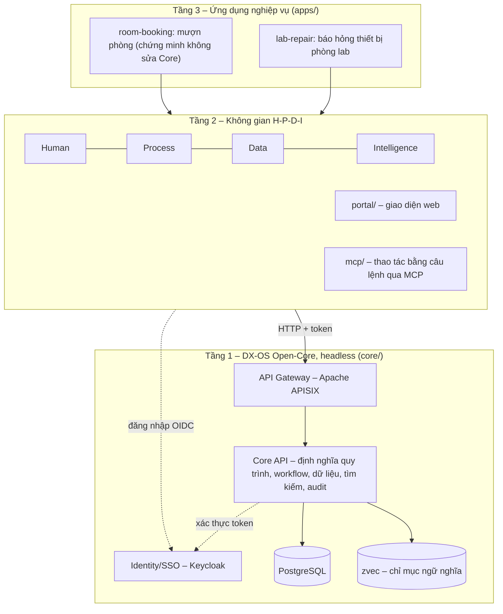

<!--
SPDX-FileCopyrightText: 2026 DX-Lab contributors

SPDX-License-Identifier: CC-BY-4.0
-->

# DX-Lab

**Trạm điều hành số trên nền tảng DX-OS Open-Core, áp dụng cho bài toán báo hỏng và xử lý sự cố
thiết bị phòng thực hành tại Đại học Công nghiệp Hà Nội (HaUI).**

[](LICENSE)
[](LICENSES/CC-BY-4.0.txt)
[](https://reuse.software/spec-3.3/)

Sản phẩm dự thi của đội **HaUI.NPC**, khối Phần mềm nguồn mở OLP 2026, chủ đề
[DX-OS Open-Core](https://vfossa.vn/tin-tuc/de-thi-phan-mem-nguon-mo-olp-2026-798.html).

> **Trạng thái:** bản **0.2.0** chạy được đầu-cuối trên một máy bằng Docker Compose với dữ liệu và tài khoản demo
> (tên giả, hạn mức giả định). Bảng [Trạng thái](#trạng-thái) ghi đúng những gì đã có và chưa có.

## Bài toán

Sinh viên và giảng viên phát hiện thiết bị phòng lab hỏng (máy tính, máy chiếu, mạng, điều hòa)
nhưng thường báo qua tin nhắn hoặc lời nói. Yêu cầu dễ thất lạc, không ai theo dõi được ai đang
xử lý, bao lâu thì xong, và tri thức sửa chữa nằm trong đầu một vài cán bộ kỹ thuật.

DX-Lab số hóa một quy trình đầu-cuối: **báo hỏng → định tuyến và xếp mức ưu tiên → kiểm tra, lập biên bản tình
trạng → xác nhận nhu cầu và duyệt theo hạn mức (khi phát sinh chi phí) → sửa chữa → nghiệm thu**, với lịch sử
thay đổi đầy đủ.

## Kiến trúc 3 tầng



Nguyên tắc: Tầng 1 không phục vụ giao diện và không biết ứng dụng nào đang gọi. Một ứng dụng Tầng 3 là một gói
định nghĩa (quy trình BPMN, bảng luật DMN, form JSON Schema) nạp vào Core qua API, không sửa mã Core.

| Không gian | Năng lực trong DX-Lab |
|---|---|
| H – Human | Đăng nhập SSO, vai trò theo đơn vị (người báo hỏng, kỹ thuật viên, trưởng lab, trưởng khoa…), kho hướng dẫn sửa chữa, thao tác bằng câu lệnh tự nhiên qua MCP |
| P – Process | Quy trình có trạng thái, người tạo, người xử lý, thời hạn, lịch sử; danh sách việc chờ xử lý; phê duyệt theo hạn mức |
| D – Data | Nguồn dữ liệu thống nhất, provenance, tìm kiếm/lọc/thống kê, dashboard, REST API có OpenAPI |
| I – Intelligence | Phân loại, định tuyến, xếp ưu tiên bằng bảng luật DMN kèm lý do; tìm hướng dẫn sửa chữa kết hợp từ khóa và ngữ nghĩa, có trích dẫn |

## Thành phần

| Thành phần | Vai trò | Giấy phép | Trạng thái |
|---|---|---|---|
| [FastAPI](https://fastapi.tiangolo.com/) | Core API (Tầng 1), máy chủ portal | MIT | Đang dùng |
| [SQLAlchemy](https://www.sqlalchemy.org/) | Truy cập dữ liệu của Core | MIT | Đang dùng |
| [psycopg](https://www.psycopg.org/) 3 | Driver PostgreSQL | LGPL-3.0 | Đang dùng |
| [Prefab](https://github.com/PrefectHQ/prefab) `prefab-ui==0.21.1` | Giao diện H-P-D-I viết bằng Python | Apache-2.0 | Đang dùng |
| [SpiffWorkflow](https://github.com/sartography/SpiffWorkflow) | Chạy quy trình BPMN và bảng luật DMN | LGPL-3.0 | Đang dùng |
| [PostgreSQL](https://www.postgresql.org/) | Dữ liệu cấu trúc, tìm kiếm toàn văn | PostgreSQL License | Đang dùng |
| [Keycloak](https://www.keycloak.org/) | Identity, SSO, RBAC | Apache-2.0 | Đang dùng |
| [Apache APISIX](https://apisix.apache.org/) | API Gateway | Apache-2.0 | Đang dùng |
| [Authlib](https://authlib.org/), [PyJWT](https://pyjwt.readthedocs.io/) | Đăng nhập OIDC ở portal, kiểm tra token ở Core | BSD-3-Clause, MIT | Đang dùng |
| [zvec](https://github.com/alibaba/zvec), [fastembed](https://github.com/qdrant/fastembed) | Chỉ mục và embedding cho tìm kiếm ngữ nghĩa | Apache-2.0 | Đang dùng |
| [FastMCP](https://github.com/PrefectHQ/fastmcp) | MCP server cho người dùng cuối | Apache-2.0 | Đang dùng |

Phiên bản cụ thể của từng gói Python nằm trong `uv.lock`; image container ghim digest trong `deploy/compose.yaml`;
mỗi bản phát hành đính kèm SBOM. Bảng phụ thuộc kèm nguồn gốc và giấy phép đang soạn (#46).

## Trạng thái

| Hạng mục | Trạng thái |
|---|---|
| Khung nguồn mở: giấy phép, REUSE, CI (pytest, gitleaks, kiểm gói), CONTRIBUTING, SECURITY, mẫu issue | Có |
| Tầng 1: Keycloak, APISIX, Core API, workflow SpiffWorkflow, phân quyền 5 lớp, tìm kiếm, thống kê | Có |
| Tầng 2: portal (báo hỏng, hộp việc, dashboard, tra cứu, trạng thái), MCP server, CLI `dxlab` | Có |
| Tầng 3: `lab-repair`, `room-booking` | Có |
| Docker Compose, dữ liệu mẫu, tài khoản demo, đặt lại dữ liệu | Có |
| Ủy quyền TUQ. (#18), che dữ liệu cá nhân trong văn bản tự do (#97) | Chưa |

## Cấu trúc thư mục

```text
core/      Gói dxlab-core: Core API headless và CLI `dxlab` (Tầng 1)
portal/    Gói dxlab-portal: giao diện web H-P-D-I (Tầng 2)
mcp/       Gói dxlab-mcp: MCP server cho thao tác bằng câu lệnh (Tầng 2)
apps/      Gói ứng dụng: lab-repair, room-booking (BPMN, DMN, form) (Tầng 3)
data/      Dữ liệu mẫu: phòng, tài sản, hướng dẫn sửa chữa (DATA_SOURCES.yml ghi nguồn)
deploy/    Docker Compose, realm Keycloak, cấu hình APISIX
scripts/   up.sh, seed.sh, reset.sh, download-models.sh
tools/     Spiff Editor (công cụ soạn quy trình, chỉ chạy trên máy người thiết kế)
docs/      Kiến trúc, phân quyền, ghi chú AI
LICENSES/  Toàn văn các giấy phép đang dùng trong repo
.github/   CI, workflow phát hành, mẫu báo lỗi
.agents/   Skill hỗ trợ phát triển cho trợ lý lập trình
```

`portal` không phụ thuộc `core` ở mức gói: hai bên chỉ giao tiếp qua HTTP tại API Gateway.

## Cài đặt từ mã nguồn

Yêu cầu: Python >= 3.12, [uv](https://docs.astral.sh/uv/), `git`. Toàn bộ là công cụ nguồn mở.

```bash
git clone https://github.com/HaUI-NPC/dx-lab.git
cd dx-lab
uv sync --all-packages
```

Kiểm tra build và tuân thủ giấy phép cấp tệp:

```bash
uv build --all-packages
uvx reuse lint
```

## Chạy thử bằng Docker Compose

Yêu cầu thêm: Docker với Compose v2, `openssl`. Chạy trong thư mục gốc của mã nguồn (bản clone hoặc tệp `.tar.gz`
của bản phát hành):

```bash
scripts/up.sh                 # tạo .env từ .env.example (sinh secret ngẫu nhiên), build, chờ mọi dịch vụ healthy
scripts/download-models.sh    # tùy chọn: tải mô hình embedding vào cache để tìm theo ngữ nghĩa, chạy offline
scripts/seed.sh               # nạp ứng dụng lab-repair, danh mục, hướng dẫn sửa chữa và phiếu mẫu (chạy lại không trùng)
```

| Dịch vụ | Địa chỉ |
|---|---|
| Portal | <http://localhost:8000> |
| API (qua APISIX) | <http://localhost:9080/api>, tài liệu tại `/api/docs` |
| Keycloak | <http://localhost:8180> |

Tài khoản demo (tên giả) liệt kê ở [`docs/AUTHZ.md`](docs/AUTHZ.md) mục 11, mật khẩu chung là giá trị
`DXLAB_DEMO_PASSWORD` trong `.env`. Ví dụ: `sv.an` (sinh viên báo hỏng), `ktv.cuong` (kỹ thuật viên), `tl.giang`
(trưởng phòng lab). Vai trò duyệt và quản trị (ví dụ `tk.hai`, `ht.khanh`) phải nhập thêm mã xác thực hai bước; sinh
mã từ khóa OTP demo trong `.env`:

```bash
python3 -c 'import hmac,hashlib,struct,time,sys;h=hmac.new(sys.argv[1].encode(),struct.pack(">Q",int(time.time())//30),hashlib.sha1).digest();o=h[-1]&15;print("%06d"%((struct.unpack(">I",h[o:o+4])[0]&0x7fffffff)%1000000))' "$(grep '^DXLAB_DEMO_OTP_SECRET=' .env | cut -d= -f2-)"
```

Mỗi mã dùng được một lần trong 30 giây. Đưa hệ thống về dữ liệu demo sạch (xóa mọi dữ liệu, dựng lại, nạp lại):

```bash
scripts/reset.sh --yes
```

## Giấy phép

| Tài sản | Giấy phép |
|---|---|
| Mã nguồn | [Apache-2.0](LICENSE), giấy phép được [OSI phê duyệt](https://opensource.org/license/apache-2.0) |
| Tài liệu (`README`, `CHANGELOG`, `CONTRIBUTING`…) | [CC BY 4.0](LICENSES/CC-BY-4.0.txt) |
| Dữ liệu bên thứ ba | Giữ nguyên giấy phép gốc, ghi nguồn và quyền sử dụng cho từng tập |

Mỗi tệp khai báo bản quyền và giấy phép theo [REUSE 3.3](https://reuse.software/spec-3.3/), bằng
SPDX header trong tệp hoặc qua [`REUSE.toml`](REUSE.toml).

## Đóng góp, quản trị và báo lỗi

- Quy trình đóng góp, yêu cầu ký nhận DCO: [`CONTRIBUTING.md`](CONTRIBUTING.md)
- Quy tắc ứng xử: [`CODE_OF_CONDUCT.md`](CODE_OF_CONDUCT.md)
- Người phụ trách và phân quyền: [`MAINTAINERS.md`](MAINTAINERS.md)
- Báo lỗi, đề xuất: [issue tracker](https://github.com/HaUI-NPC/dx-lab/issues)
- Báo lỗ hổng bảo mật: [`SECURITY.md`](SECURITY.md), **không** mở issue công khai
