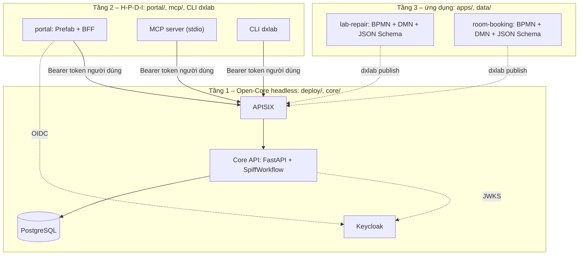

<!--
SPDX-FileCopyrightText: 2026 DX-Lab contributors

SPDX-License-Identifier: CC-BY-4.0
-->

# Báo cáo kỹ thuật DX-Lab — Phần 1: Bài toán, Kiến trúc Open-Core, Giấy phép và Bằng chứng nguồn mở

> **Dự án:** Trạm điều hành số trên nền tảng DX-OS Open-Core (DX-Lab)  
> **Đội thi:** HaUI.NPC — Khối Phần mềm nguồn mở, Olympic Tin học Sinh viên Việt Nam 2026  
> **Mã nguồn:** <https://github.com/HaUI-NPC/dx-lab> (bản phát hành `v0.2.0`)  
> **Tài liệu liên quan:** Phần 2 ([`BAO-CAO-PHAN-2.md`](BAO-CAO-PHAN-2.md): H-P-D-I, ứng dụng, AI, đánh giá), [`docs/ARCHITECTURE.md`](../ARCHITECTURE.md), [`docs/AUTHZ.md`](../AUTHZ.md), [`docs/DEPENDENCIES.md`](../DEPENDENCIES.md)

Mọi khẳng định trong báo cáo đều dẫn tới tệp trong repo để Hội đồng kiểm lại. Những gì chưa chạy được ở bản `v0.2.0`
được nêu riêng ở mục 8.4, không mô tả như tính năng đã có.

---

## 1. Bài toán và phạm vi

Sinh viên và giảng viên phát hiện thiết bị phòng lab hỏng nhưng thường báo qua tin nhắn hoặc lời nói. Yêu cầu dễ
thất lạc, không ai theo dõi được ai đang xử lý, chi phí sửa chữa không đi qua đúng cấp duyệt, còn tri thức sửa chữa
nằm trong đầu một vài cán bộ kỹ thuật (`README.md`, mục "Bài toán").

Đề thi yêu cầu **Open-Core trước, ứng dụng sau** (đề mục 3): không được dừng ở một ứng dụng web có dashboard hoặc AI.
DX-Lab trả lời bằng cách tách hai việc:

- **Nền tảng dùng chung** (Tầng 1): định danh/SSO, cổng API, dữ liệu, bộ máy quy trình. Nền tảng này không biết ứng
  dụng nghiệp vụ nào đang chạy trên nó.
- **Ứng dụng minh họa** (Tầng 3): `lab-repair` (xử lý sự cố thiết bị phòng lab, sáu bước từ báo hỏng tới nghiệm thu) và
  `room-booking` (mượn phòng thực hành), cả hai chỉ là gói tệp dữ liệu nạp vào nền tảng.

Phạm vi `v0.2.0` được liệt kê ở `README.md` mục "Trạng thái" và `CHANGELOG.md` mục `[0.2.0]`. Nội dung H-P-D-I, nghiệp
vụ `lab-repair` và đánh giá AI trình bày ở Phần 2, không lặp lại ở đây.

## 2. Kiến trúc Open-Core ba tầng

*Hình 1. Ba tầng và hướng phụ thuộc, rút gọn từ `docs/ARCHITECTURE.md` mục 1.*

### 2.1 Tầng 1 — Open-Core headless (`deploy/`, `core/`)

Đáp ứng đề mục 4.1: Identity, cổng API, dữ liệu, workflow, và tách UI khỏi Core.

| Dịch vụ dùng chung | Thành phần nguồn mở | Vai trò | Nơi cấu hình |
|---|---|---|---|
| Identity / SSO | Keycloak 26.8.1 (Apache-2.0) | Đăng nhập, nhóm theo cây tổ chức, OTP cho vai trò duyệt, cấp JWT | `deploy/keycloak/realm.json` |
| API Gateway | Apache APISIX 3.19.0 (Apache-2.0) | Cửa duy nhất vào Core: kiểm JWT bằng JWKS, giới hạn tốc độ, gắn `X-Request-Id` | `deploy/apisix/apisix.yaml` |
| Dữ liệu cấu trúc | PostgreSQL 17.11 (PostgreSQL License) | Phiếu, bước, danh mục, audit, tìm kiếm toàn văn | `core/src/dxlab_core/db` |
| Workflow | SpiffWorkflow nhúng trong Core (LGPL-3.0) | Chạy BPMN 2.0, đánh giá DMN 1.3, lưu trạng thái bền vững | `core/src/dxlab_core/workflows`, `tasks` |

Điểm kiến trúc then chốt, đều có trong `docs/ARCHITECTURE.md` mục 1–3:

1. **Core không trả HTML, không biết tên ứng dụng, không gọi LLM** (bảng mục 1). Giao diện thuộc Tầng 2.
2. **Chỉ Core được đọc/ghi PostgreSQL và volume tài liệu**; cổng của Core không bind ra máy chủ, APISIX là điểm vào
   duy nhất `127.0.0.1:9080` (mục 3.6, mục 4).
3. **Ranh giới import được kiểm bằng khai báo phụ thuộc**: `dxlab-core` không được import `dxlab_portal`, `prefab_ui`, `fastmcp`;
   `dxlab-portal` không được import `dxlab_core`, `SpiffWorkflow`, `sqlalchemy` (mục 2; mỗi gói chỉ khai báo phụ thuộc của riêng nó
   trong `core/pyproject.toml`, `portal/pyproject.toml`).
4. API công bố bằng OpenAPI: `http://localhost:9080/api/openapi.json`, giao diện thử tại `/api/docs`.

### 2.2 Tầng 2 — Giao diện và năng lực H-P-D-I (`portal/`, `mcp/`, CLI)

Ba cách người dùng chạm tới Core, cùng dùng **token của chính người dùng** (không có tài khoản dịch vụ):

| Thành phần | Vai trò | Ghi chú kỹ thuật |
|---|---|---|
| Portal (`portal/`) | Giao diện web tiếng Việt: dashboard, báo hỏng, việc của tôi, tra cứu, trạng thái hệ thống | Prefab UI qua BFF: token OAuth2 ở phiên phía máy chủ, trình duyệt chỉ giữ cookie `httpOnly` |
| MCP server (`mcp/src/dxlab_mcp/server.py`) | Công cụ `bao_hong`, `viec_cua_toi`, `tra_cuu_phieu`, `tim_huong_dan`, `hoan_thanh_viec` cho trợ lý | Thao tác ghi bắt buộc hỏi xác nhận; chạy stdio trên máy người dùng |
| CLI `dxlab` (`core/src/dxlab_core/cli`) | `login`, `validate`, `publish`, `whoami`, `logout` | Đăng nhập device flow; `validate` dùng chính validator của Core nên CI và Core không lệch nhau |

### 2.3 Tầng 3 — Ứng dụng không sửa Core (`apps/`, `data/`)

`apps/lab-repair/` gồm `lab-repair.bpmn`, ba bảng luật chính `triage.dmn`, `routing.dmn`, `authority.dmn` (cùng
`overrun.dmn` cho duyệt lại), các cặp `*-schema.json`/`*-uischema.json` và dữ liệu danh mục. `apps/room-booking/` có
cấu trúc tương tự (`room-booking.bpmn`, `conflict.dmn`, form). `apps/` chỉ chứa `.bpmn`, `.dmn`, `.json`, `.md`;
validator từ chối gói có script. Ứng dụng thứ hai được nạp qua `/api/definitions` mà không đổi `core/` hay `portal/`
(`docs/ARCHITECTURE.md` mục 1; `apps/room-booking/README.md`). Đây là câu trả lời cho câu hỏi "đổi ứng dụng, Core có
đổi theo không?": không, ngoại trừ khi cần một năng lực nền tảng mới dùng chung cho mọi ứng dụng.

## 3. Luồng gọi dịch vụ

Chứng minh ứng dụng tầng trên dùng Open-Core (đề mục 4.1, ý cuối): mọi thao tác nghiệp vụ đều là một lời gọi
`/api/...` qua APISIX. Ví dụ báo hỏng từ portal (chi tiết đầy đủ ở `docs/ARCHITECTURE.md` mục 3.1–3.5):

| Bước | Thành phần | Việc làm |
|---|---|---|
| 1 | Portal ↔ Keycloak | Đăng nhập Authorization Code + PKCE; token lưu ở phiên phía máy chủ |
| 2 | Portal → APISIX | `POST /api/workflows` kèm `Authorization: Bearer <token người dùng>` |
| 3 | APISIX | Kiểm chữ ký JWT bằng JWKS của Keycloak, giới hạn tốc độ, gắn `X-Request-Id` |
| 4 | Core | Tự kiểm lại `iss`, `aud`, `exp`; kiểm 5 lớp phân quyền; kiểm dữ liệu theo JSON Schema của form |
| 5 | Core + SpiffWorkflow | Khởi tạo quy trình, chạy `triage.dmn` và `routing.dmn`, dừng ở bước người dùng kế tiếp |
| 6 | Core → PostgreSQL | Lưu trạng thái, tạo việc trong hộp việc, ghi audit |
| 7 | Core → Portal | Trả JSON, trường dữ liệu cá nhân đã che theo quyền người xem |

Nguyên tắc "APISIX chặn sớm, Core quyết định độc lập" (mục 3.6) nghĩa là gateway sai cấu hình cũng không mở được quyền
mà Core không cho. Portal và MCP chỉ ẩn nút theo vai trò để thuận tiện; quyết định cho phép hay từ chối luôn ở Core.

## 4. Quản trị thay đổi định nghĩa (`/api/definitions`)

Quy trình, luật và form là dữ liệu, nên thay đổi chúng cũng phải được kiểm soát như thay đổi mã. Router ở
`core/src/dxlab_core/definitions/router.py`, quy tắc ở `CHANGELOG.md` mục `[0.2.0]`:

1. **Nạp**: `POST /api/definitions/{app_id}/versions` (multipart, hoặc `dxlab publish apps/<app>`). Validator từ chối
   script và điều kiện không an toàn, trả `DEFINITION_REJECTED` kèm danh sách lỗi. Mỗi lần nạp là một **phiên bản mới**;
   không có thay đổi thì trả 409.
2. **Phân quyền nạp**: `rule_admin` chỉ nạp được thay đổi `.dmn`; thay đổi khác cần `process_admin`.
3. **Duyệt**: `POST .../versions/{n}/activate` do `process_owner` làm, và phải là **người khác người nạp**.
4. **Áp dụng**: phiếu mới dùng phiên bản mới, phiếu đã tạo giữ nguyên luật của phiên bản tạo ra nó.

Kịch bản 13 trong `docs/AUTHZ.md` mục 12 là ví dụ cụ thể: đổi hạn mức trưởng khoa từ 5 lên 10 triệu, phiếu mới 8 triệu
do trưởng khoa duyệt, phiếu cũ vẫn theo luật cũ.

## 5. Phân quyền năm lớp (tóm tắt)

Chi tiết, căn cứ pháp lý và nhãn "giả định" ở [`docs/AUTHZ.md`](../AUTHZ.md). Core kiểm theo thứ tự, mặc định **từ chối**:

| Lớp | Câu hỏi | Nơi lấy dữ liệu | Mã lỗi |
|---|---|---|---|
| 1. Ai là ai | Token hợp lệ không, vai trò gì ở đơn vị nào? | Nhóm trong Keycloak | `UNAUTHENTICATED`, `FORBIDDEN_ROLE` |
| 2. Phạm vi | Đối tượng thuộc đơn vị của người làm (kể cả đơn vị con)? | Cây đơn vị trong Core | `FORBIDDEN_SCOPE` |
| 3. Thẩm quyền | Hạn mức đủ không, hoặc có ủy quyền còn hạn? | `authority.dmn`, `/api/delegations` | `FORBIDDEN_AUTHORITY` |
| 4. Không kiêm nhiệm | Có đang tự duyệt, tự nghiệm thu việc mình làm? | `dxlabExcludeActorsOf` trên bước BPMN | `FORBIDDEN_SOD` |
| 5. Dữ liệu cá nhân | Có được thấy liên hệ người báo? | `x-personal-data` trong schema | Trường bị che |

Xác thực hai bước (OTP Keycloak) bắt buộc cho vai trò duyệt và quản trị (`docs/AUTHZ.md` mục 10).

## 6. Giấy phép và quản lý phụ thuộc

| Tài sản | Giấy phép | Cách khai báo |
|---|---|---|
| Mã nguồn, script, cấu hình build | Apache-2.0 (`LICENSE`, `LICENSES/Apache-2.0.txt`) | Header SPDX trong tệp |
| Tài liệu (README, CHANGELOG, báo cáo…) | CC BY 4.0 (`LICENSES/CC-BY-4.0.txt`) | Header SPDX trong tệp |
| Tệp không chứa được comment (`.bpmn`, `.dmn`, `.json`, `uv.lock`) | Theo loại tệp | Chú thích tập trung trong `REUSE.toml` |
| Dữ liệu bên thứ ba | Giữ nguyên giấy phép gốc | `DATA_SOURCES.yml` |

- Repo tuân thủ **REUSE 3.3**; CI chạy `reuse lint` và là điều kiện bắt buộc (`.github/workflows/ci.yml`, job
  "Tuân thủ giấy phép (REUSE 3.3)").
- **Bảng phụ thuộc** ở [`docs/DEPENDENCIES.md`](../DEPENDENCIES.md): mục 2 image container ghim theo digest
  `sha256` (PostgreSQL, Keycloak, APISIX, image nền Python, `uv`); mục 3 mô hình embedding
  `paraphrase-multilingual-MiniLM-L12-v2` (Apache-2.0); mục 4 khai báo thành phần đóng gói sẵn (bundled) theo quy ước
  Fedora cho bộ giao diện của `prefab-ui`; mục 5 toàn bộ gói Python lấy từ `uv.lock`, có phiên bản và mã băm.
- Không commit thư viện chép tay; thư viện đi qua `uv.lock`. Không có LLM hay dịch vụ đóng trong compose sản phẩm
  (`docs/ARCHITECTURE.md`, mục danh sách được phép dùng).
- Cấu hình mẫu ở `.env.example`; `.env` không commit, `scripts/up.sh` sinh ngẫu nhiên mọi secret để trống. CI có job
  quét secret bằng gitleaks.

## 7. Bằng chứng nguồn mở

Số liệu lấy ngày 01/11/2026 từ `git log` và `gh` trên `HaUI-NPC/dx-lab`; các số này tăng theo thời gian.

| Bằng chứng | Số liệu / vị trí kiểm |
|---|---|
| Repo công khai, có lịch sử commit thực | 104 commit trên `main` tại `c4f3f3b`, commit đầu `5d15b80` (khung tuân thủ); `git log` |
| Release có phiên bản | `v0.2.0`, công bố 30/10/2026. Tệp kèm: `dx-lab-v0.2.0.tar.gz`, `SHA256SUMS`, SBOM `dx-lab-v0.2.0.cdx.json` (CycloneDX) và `dx-lab-v0.2.0.spdx.json` (SPDX); `gh release view v0.2.0` |
| Quy trình phát hành | `.github/workflows/release.yml` (có bước `sha256sum -c SHA256SUMS`); `CHANGELOG.md` |
| CI bắt buộc | Năm job trong `.github/workflows/ci.yml`: REUSE; build wheel/sdist và cài sạch chạy ngoài cây mã; DCO (`Signed-off-by` từng commit); gitleaks; pytest toàn workspace cùng `dxlab validate apps/` |
| Issue, PR, review | 33 PR đã gộp và 54 issue (mọi trạng thái); mỗi thay đổi gắn issue, PR theo mẫu `.github/pull_request_template.md`, cần review của người khác tác giả, chỉ maintainer gộp bằng rebase (`CONTRIBUTING.md`, `MAINTAINERS.md`) |
| Tái lập từ source | `uv sync --all-packages`, `uv build --all-packages`, `scripts/up.sh`; hướng dẫn ở `README.md` |
| Tài liệu cộng đồng | `README.md`, `CHANGELOG.md` (Keep a Changelog), `CONTRIBUTING.md`, `CODE_OF_CONDUCT.md`, `SECURITY.md`, `MAINTAINERS.md` |

## 8. Đối chiếu yêu cầu đề thi

### 8.1 Đề mục 4.1 — Tầng 1

| Yêu cầu đề | Đáp ứng | Dẫn chứng |
|---|---|---|
| Identity / Authentication / Authorization | Có: Keycloak, 5 lớp phân quyền | `deploy/keycloak/realm.json`, `docs/AUTHZ.md` |
| API Gateway | Có: APISIX standalone, JWT + rate limit | `deploy/apisix/apisix.yaml` |
| Dữ liệu cấu trúc và/hoặc phi cấu trúc | Có: PostgreSQL; tài liệu và chỉ mục vector trên volume | `core/src/dxlab_core/db`, `documents`, `search` |
| Workflow Engine | Có: SpiffWorkflow, trạng thái, lịch sử, audit | `core/src/dxlab_core/workflows`, `audit` |
| Tách UI khỏi Core | Có: Core không trả HTML; import bị cấm chéo | `docs/ARCHITECTURE.md` mục 1–2 |
| Sơ đồ kiến trúc và luồng gọi | Có | Hình 1; `docs/ARCHITECTURE.md` mục 3 |

### 8.2 Đề mục 5 — Nguồn mở (PoF)

| Yêu cầu đề | Đáp ứng | Dẫn chứng |
|---|---|---|
| Repo công khai, có lịch sử commit | Có | Mục 7 |
| LICENSE rõ; bảng dependency + license | Có | `LICENSE`, `docs/DEPENDENCIES.md` |
| Ít nhất một release/tag | Có: `v0.2.0` | `gh release view v0.2.0` |
| Build/install/run từ source theo README | Có | `README.md`, job build trong CI |
| README: kiến trúc, cài đặt, cấu hình, chạy thử, API, tài khoản demo | Có | `README.md`, `docs/AUTHZ.md` mục 11 |
| CHANGELOG, issue tracker, CONTRIBUTING | Có | `CHANGELOG.md`, `CONTRIBUTING.md` |
| Không commit secret | Có biện pháp: `.env` ngoài git, `.env.example`, gitleaks trong CI | `.github/workflows/ci.yml` |
| Không dùng thành phần đóng hoặc giấy phép không rõ | Mọi thành phần có giấy phép ghi trong bảng phụ thuộc | `docs/DEPENDENCIES.md` |
| Ghi nguồn gốc, phiên bản, giấy phép, vai trò thành phần ngoài | Có | `docs/DEPENDENCIES.md` mục 2–5 |

### 8.3 Đề mục 10 — Hồ sơ nộp

| Hạng mục | Trạng thái |
|---|---|
| Repository công khai, release/tag | Có (mục 7) |
| README, LICENSE, bảng dependency/license | Có |
| CHANGELOG, issue tracker, CONTRIBUTING | Có |
| Báo cáo kỹ thuật | Phần 1 (tài liệu này) và Phần 2 (`BAO-CAO-PHAN-2.md`) |
| Slide demo (tối đa 12 slide), video 3–5 phút | Chưa có trong repo tại thời điểm viết; kịch bản demo 10 phút đang soạn ở issue #53 |

### 8.4 Việc thuộc lộ trình, chưa có ở `v0.2.0`

- LLM cho MCP host (issue #36) và che dữ liệu cá nhân trong văn bản tự do bằng OpenMed (issue #97): chưa có, không
  được coi là tính năng đã chạy. Core không gọi LLM theo thiết kế.
- Cấu hình Keycloak `start-dev` và một máy là cấu hình demo; triển khai thật cần TLS và cơ sở dữ liệu riêng
  (`docs/ARCHITECTURE.md` mục 4).
- Căn cứ pháp lý/quy chế mang nhãn `GĐ-…` là **giả định** của dự án, không phải quy chế thật của HaUI (`docs/AUTHZ.md`
  mục 0).
