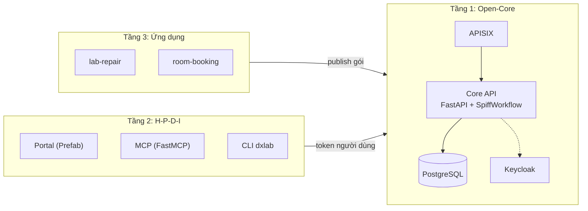
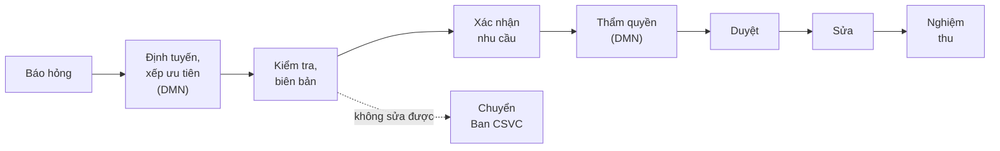

<div class="mb-6"><carbon-cloud-services class="text-6xl" /></div>

# DX-Lab

<div class="text-2xl">Trạm điều hành số cho phòng thực hành, trên nền DX-OS Open-Core</div>

<div class="mt-12 text-lg">Đội <b>HaUI.NPC</b> · OLP Phần mềm nguồn mở 2026 · bản <b>v0.2.1</b></div>

<div class="text-sm mt-6 opacity-80">github.com/HaUI-NPC/dx-lab</div>

<style>
:global(.slidev-layout h1) { border-left: 10px solid var(--slidev-theme-primary); padding-left: 18px; margin-bottom: 1.2rem; font-weight: 700; }
:global(.slidev-layout.cover h1) { border-left: 0; padding-left: 0; font-size: 5rem; color: #fff; }
:global(.slidev-layout.cover) { background: linear-gradient(135deg, #1e3a8a 0%, #1d4ed8 55%, #0ea5e9 100%) !important; color: #fff; }
:global(.slidev-layout.cover p), :global(.slidev-layout.cover div) { color: #e0f2fe; }
:global(.slidev-layout table) { width: 100%; border: 1px solid #cbd5e1; border-radius: 8px; border-collapse: separate; border-spacing: 0; overflow: hidden; font-size: 0.9em; }
:global(.slidev-layout thead tr) { background: #1d4ed8; color: #fff; }
:global(.slidev-layout tbody tr:nth-child(even)) { background: #eff6ff; }
:global(.slidev-layout th), :global(.slidev-layout td) { padding: 0.45rem 0.9rem !important; }
:global(.badge) { display: inline-block; padding: 1px 12px; border-radius: 999px; font-size: 0.7em; font-weight: 600; color: #fff; vertical-align: middle; }
:global(.badge-assumed) { background: #d97706; }
:global(.badge-roadmap) { background: #7c3aed; }
:global(.badge-done) { background: #15803d; }
:global(.card) { border: 1px solid #bfdbfe; background: #eff6ff; border-radius: 12px; padding: 0.9rem 1rem; }
</style>

---

# Bài toán

<div class="grid grid-cols-2 gap-6 mb-6">
<div class="card"><carbon-warning-alt class="text-3xl text-orange-600" /><br>Báo hỏng máy tính, máy chiếu, mạng, điều hòa qua tin nhắn hay lời nói thì <b>thất lạc</b>: không biết ai đang xử lý, bao lâu thì xong.</div>
<div class="card"><carbon-document-unknown class="text-3xl text-orange-600" /><br>Khi cần chi tiền sửa chữa: ai có quyền duyệt, ai kiểm tra, ai nghiệm thu thường <b>không rõ ràng, không có dấu vết</b>.</div>
</div>

**DX-Lab số hóa đầu-cuối:**

báo hỏng → định tuyến, xếp ưu tiên → kiểm tra, lập biên bản → xác nhận nhu cầu, duyệt theo hạn mức → sửa → nghiệm thu

Mọi thao tác có lịch sử audit. Bản 0.2.1 chạy được đầu-cuối trên một máy bằng Docker Compose.

<div class="abs-br m-5 text-xs opacity-60"><SlideCurrentNo /> / <SlidesTotal /></div>

---

# Kiến trúc 3 tầng



Tầng trên chỉ gọi tầng dưới qua API; không đọc cơ sở dữ liệu, không sửa Core.

<div class="abs-br m-5 text-xs opacity-60"><SlideCurrentNo /> / <SlidesTotal /></div>

---

# Tầng 1: Open-Core (headless)

| Thành phần | Việc làm |
|---|---|
| **Keycloak 26** | SSO, OIDC, vai trò theo cây đơn vị, OTP cho vai trò duyệt |
| **Apache APISIX 3.19** | Cổng duy nhất vào `/api`: JWT/JWKS, giới hạn tần suất |
| **Core API (FastAPI)** | `definitions`, `workflows`, `tasks`, `records`, `documents`, `search`, `stats`, `delegations` |
| **SpiffWorkflow** | Chạy BPMN và bảng luật DMN |
| **PostgreSQL 17 + zvec** | Dữ liệu, toàn văn, chỉ mục vector cục bộ |

Core **không trả HTML, không biết ứng dụng cụ thể, không gọi LLM**. Thêm ứng dụng = nạp gói BPMN, DMN, JSON Schema qua `/api/definitions`.

<div class="abs-br m-5 text-xs opacity-60"><SlideCurrentNo /> / <SlidesTotal /></div>

---
layout: two-cols
---

# Tầng 2: bốn không gian H-P-D-I

<div class="mt-2"></div>

<div class="card mb-3"><carbon-user-avatar class="text-primary" /> <b>Human</b>: Portal (SSO, 6 tab), CLI <code>dxlab</code>, MCP (5 tool, ghi phải xác nhận)</div>
<div class="card mb-3"><carbon-flow class="text-primary" /> <b>Process</b>: hộp việc theo vai trò và phạm vi, thời hạn, audit</div>
<div class="card mb-3"><carbon-data-base class="text-primary" /> <b>Data</b>: danh mục phòng, thiết bị theo schema, tài liệu có nguồn, dashboard không chứa tên người</div>
<div class="card"><carbon-rule class="text-primary" /> <b>Intelligence</b>: DMN có mã lý do, tìm hướng dẫn sửa chữa có trích dẫn</div>

::right::

<div class="pl-8 mt-4">

**6 tab Portal**

1. Việc của tôi
2. Báo hỏng
3. Tra cứu
4. Dashboard
5. Sơ đồ quy trình
6. Trạng thái hệ thống

<div class="mt-6 text-sm">Form sinh từ JSON Schema của ứng dụng, không viết tay từng màn hình. Portal, MCP, CLI dùng <b>token của chính người dùng</b>.</div>

</div>

<div class="abs-br m-5 text-xs opacity-60"><SlideCurrentNo /> / <SlidesTotal /></div>

---

# Quy trình `lab-repair` (BPMN + DMN)



<div class="grid grid-cols-3 gap-4 mt-6 text-center">
<div class="card"><div class="text-4xl font-bold text-primary">4</div>bảng luật DMN: định tuyến, xếp ưu tiên, thẩm quyền, chi phí vượt</div>
<div class="card"><div class="text-4xl font-bold text-primary">7</div>bước có form; dữ liệu mẫu: 4 phòng, 12 tài sản, 8 hướng dẫn sửa chữa</div>
<div class="card"><div class="text-lg font-bold text-primary mt-2">Ngoài hệ thống</div>mua sắm và thanh lý</div>
</div>

<div class="abs-br m-5 text-xs opacity-60"><SlideCurrentNo /> / <SlidesTotal /></div>

---

# Phân quyền 5 lớp và ủy quyền TUQ.

Core kiểm tuần tự cho mọi thao tác, **mặc định từ chối**:

1. **Ai là ai**: token và vai trò từ nhóm Keycloak (`FORBIDDEN_ROLE`)
2. **Phạm vi**: đối tượng thuộc đơn vị của người làm, kể cả đơn vị con (`FORBIDDEN_SCOPE`)
3. **Thẩm quyền**: hạn mức từ `authority.dmn` hoặc ủy quyền còn hạn (`FORBIDDEN_AUTHORITY`)
4. **Không kiêm nhiệm**: không tự duyệt, không tự nghiệm thu (`FORBIDDEN_SOD`)
5. **Dữ liệu cá nhân**: trường `x-personal-data` bị che, người khác xem đều ghi log

<div class="card mt-4"><b>TUQ.</b> (<code>/api/delegations</code>): có số giấy, tối đa 30 ngày, cùng đơn vị, không vượt hạn mức người ủy quyền, không ủy quyền lại; audit ghi người làm thật, người ủy quyền, số giấy. Hạn mức là <span class="badge badge-assumed">giả định</span></div>

<div class="abs-br m-5 text-xs opacity-60"><SlideCurrentNo /> / <SlidesTotal /></div>

---

# Intelligence: có giải trình, người quyết định

- **DMN, không dùng mô hình học máy**: mỗi quyết định kèm mã lý do (`HAZARD_REPORTED`, `ROOM_BLOCKED`, `REPORTER_URGENT`, `DEFAULT`).
- **Tìm kiếm kết hợp**: toàn văn PostgreSQL + vector `zvec`, mô hình đa ngôn ngữ chạy cục bộ; thiếu mô hình thì chỉ dùng toàn văn.

<div class="grid grid-cols-4 gap-4 mt-6 text-center">
<div class="card"><div class="text-4xl font-bold text-primary">88,3%</div><div class="text-sm">mức ưu tiên đúng, 53/60 phiếu</div></div>
<div class="card"><div class="text-4xl font-bold text-primary">83,3%</div><div class="text-sm">định tuyến đúng cả đơn vị và vai trò, 50/60</div></div>
<div class="card"><div class="text-3xl font-bold text-primary mt-1">17/18 → 18/18</div><div class="text-sm">tìm kiếm top-1: từ khóa → kết hợp</div></div>
<div class="card"><div class="text-3xl font-bold text-primary mt-1">0/2 → 2/2</div><div class="text-sm">câu ngoài phạm vi trả rỗng</div></div>
</div>

<div class="text-sm opacity-80 mt-4">Số đo từ <code>docs/AI.md</code>. Phiếu là dữ liệu <b>tổng hợp</b>, nhãn do agent soạn, <b>chưa có người rà</b>; mẫu nhỏ. Duyệt chi phí và nghiệm thu luôn do người có thẩm quyền.</div>

<div class="abs-br m-5 text-xs opacity-60"><SlideCurrentNo /> / <SlidesTotal /></div>

---

# Chứng minh không sửa Core: `room-booking`

- Ứng dụng thứ hai được thêm **chỉ bằng gói dữ liệu**: `room-booking.bpmn`, `conflict.dmn`, form JSON Schema, `process_model.json`.
- Dùng lại danh mục phòng của `lab-repair` qua `record_bindings`.
- Nạp bằng `dxlab publish` → `/api/definitions`; **không đổi một dòng** trong `core/` hay `portal/`.
- Validator của Core từ chối gói chứa mã script; `dxlab validate` dùng chính validator đó.
- Phiên bản mới cần **người khác người nạp** duyệt mới được áp dụng; phiếu cũ giữ luật phiên bản đã tạo ra nó.

<div class="text-sm opacity-80 mt-4">Giới hạn: ứng dụng không tự kiểm tra lịch; người đề nghị khai báo xung đột, quyết định duyệt bắt buộc ghi lý do.</div>

<div class="abs-br m-5 text-xs opacity-60"><SlideCurrentNo /> / <SlidesTotal /></div>

---

# Nguồn mở và bằng chứng (PoF)

<div class="text-sm">

| Mục | Hiện trạng |
|---|---|
| Giấy phép | Mã **Apache-2.0**, tài liệu **CC BY 4.0**; REUSE 3.3 (`uvx reuse lint`); mọi commit ký DCO |
| Phụ thuộc | `docs/DEPENDENCIES.md`: gói, image, mô hình, giấy phép |
| CI | pytest trên PostgreSQL 17 thật, gitleaks, `dxlab validate apps/`, kiểm DCO |
| Phát hành | **v0.2.1**: tarball, SBOM (CycloneDX, SPDX), `SHA256SUMS` |
| QA-01 | Dựng từ mã nguồn theo README; `demo-e2e.sh` đạt ở lần 2. Chạy trên **máy của mentor**, chưa phải máy sạch khác |

</div>

<div class="abs-br m-5 text-xs opacity-60"><SlideCurrentNo /> / <SlidesTotal /></div>

---

# Demo và cách chạy

```bash
git clone https://github.com/HaUI-NPC/dx-lab.git && cd dx-lab
scripts/up.sh && scripts/download-models.sh && scripts/seed.sh
scripts/demo-e2e.sh        # chạy lại kịch bản bằng curl qua APISIX
```

Mở `http://localhost:8000` (17 tài khoản demo <span class="badge badge-assumed">giả định</span>, mật khẩu theo `DXLAB_DEMO_PASSWORD`):

1. `sv.an` báo máy chiếu A1-305 không lên hình → định tuyến về Trung tâm CNTT
2. `ktv.cuong` lập biên bản, dự toán 3.500.000 đ → `tl.giang` xác nhận → `tk.hai` duyệt (OTP)
3. Sửa → nghiệm thu → phiếu đóng, audit đầy đủ
4. Thử chặn: `tk.long` duyệt phiếu khoa khác bị từ chối; `admin.dx` không duyệt được phiếu nào

<div class="abs-br m-5 text-xs opacity-60"><SlideCurrentNo /> / <SlidesTotal /></div>

---
layout: two-cols
---

# Lộ trình và liên kết

<div class="mb-3"><span class="badge badge-roadmap">lộ trình</span> sau cuộc thi, <b>chưa có</b> trong v0.2.1</div>

- **#36** MCP server với host mã nguồn mở và LLM mở
- **#97** Che dữ liệu cá nhân trong ô văn bản tự do bằng mô hình PII (dự kiến OpenMed)
- **#96** Đo tải và tối ưu migration bảng lớn
- Chống chia nhỏ chi phí (E3) mới ở mức thiết kế; portal chưa có màn hình tạo ủy quyền (dùng API)

::right::

<div class="pl-8 mt-24">

<div class="card mb-4"><carbon-logo-github class="text-2xl" /> <b>Mã nguồn</b><br>github.com/HaUI-NPC/dx-lab</div>

<div class="card mb-4"><carbon-tag class="text-2xl" /> <b>Bản phát hành</b><br>github.com/HaUI-NPC/dx-lab/releases/tag/v0.2.1</div>

<div class="text-sm opacity-70">Cảm ơn Hội đồng. Hạn mức, cơ cấu tổ chức, tài khoản demo là giả định của đội HaUI.NPC.</div>

</div>

<div class="abs-br m-5 text-xs opacity-60"><SlideCurrentNo /> / <SlidesTotal /></div>
