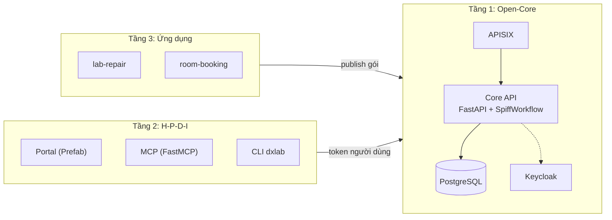
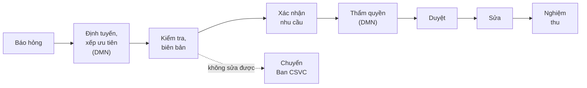

# DX-Lab

Trạm điều hành số cho phòng thực hành, trên nền DX-OS Open-Core

<br>

Đội **HaUI.NPC** · OLP Phần mềm nguồn mở 2026 · bản **v0.2.1**

<div class="text-sm opacity-70 mt-8">github.com/HaUI-NPC/dx-lab</div>

---

# Bài toán

- Báo hỏng máy tính, máy chiếu, mạng, điều hòa qua tin nhắn hay lời nói thì **thất lạc**: không biết ai đang xử lý, bao lâu thì xong.
- Khi cần chi tiền sửa chữa: ai có quyền duyệt, ai kiểm tra, ai nghiệm thu thường **không rõ ràng, không có dấu vết**.

<br>

**DX-Lab số hóa đầu-cuối:**

báo hỏng → định tuyến, xếp ưu tiên → kiểm tra, lập biên bản → xác nhận nhu cầu, duyệt theo hạn mức → sửa → nghiệm thu

Mọi thao tác có lịch sử audit. Bản 0.2.1 chạy được đầu-cuối trên một máy bằng Docker Compose.

---

# Kiến trúc 3 tầng




Tầng trên chỉ gọi tầng dưới qua API; không đọc cơ sở dữ liệu, không sửa Core.

---

# Tầng 1: Open-Core (headless)

| Thành phần | Việc làm |
|---|---|
| **Keycloak 26** | SSO, OIDC, vai trò theo cây đơn vị, OTP cho vai trò duyệt |
| **Apache APISIX 3.19** | Cổng duy nhất vào `/api`: JWT/JWKS, giới hạn tần suất |
| **Core API (FastAPI)** | `definitions`, `workflows`, `tasks`, `records`, `documents`, `search`, `stats`, `delegations` |
| **SpiffWorkflow** | Chạy BPMN và bảng luật DMN |
| **PostgreSQL 17 + zvec** | Dữ liệu, toàn văn, chỉ mục vector cục bộ |

Core **không trả HTML, không biết ứng dụng cụ thể, không gọi LLM**. Thêm ứng dụng = nạp gói BPMN, DMN, JSON Schema qua `/api/definitions`.

---
layout: two-cols
---

# Tầng 2: bốn không gian H-P-D-I

Người dùng chạm tới bốn không gian:

**Human**: Portal (SSO, 6 tab), CLI `dxlab`, MCP (5 tool, ghi phải xác nhận)

**Process**: hộp việc theo vai trò và phạm vi, thời hạn, audit

**Data**: danh mục phòng, thiết bị theo schema, tài liệu có nguồn, dashboard không chứa tên người

**Intelligence**: DMN có mã lý do, tìm hướng dẫn sửa chữa có trích dẫn

::right::

<div class="pl-6 mt-16">

**6 tab Portal**

1. Việc của tôi
2. Báo hỏng
3. Tra cứu
4. Dashboard
5. Sơ đồ quy trình
6. Trạng thái hệ thống

<br>

Form sinh từ JSON Schema của ứng dụng, không viết tay từng màn hình. Portal, MCP, CLI dùng **token của chính người dùng**.

</div>

---

# Quy trình `lab-repair` (BPMN + DMN)




- 4 bảng luật DMN: định tuyến, xếp ưu tiên, thẩm quyền, chi phí vượt; form cho 7 bước
- Dữ liệu mẫu: 4 phòng, 12 tài sản, 8 hướng dẫn sửa chữa
- Mua sắm và thanh lý nằm ngoài hệ thống

---

# Phân quyền 5 lớp và ủy quyền TUQ.

Core kiểm tuần tự cho mọi thao tác, **mặc định từ chối**:

1. **Ai là ai**: token và vai trò từ nhóm Keycloak (`FORBIDDEN_ROLE`)
2. **Phạm vi**: đối tượng thuộc đơn vị của người làm, kể cả đơn vị con (`FORBIDDEN_SCOPE`)
3. **Thẩm quyền**: hạn mức từ `authority.dmn` hoặc ủy quyền còn hạn (`FORBIDDEN_AUTHORITY`)
4. **Không kiêm nhiệm**: không tự duyệt, không tự nghiệm thu (`FORBIDDEN_SOD`)
5. **Dữ liệu cá nhân**: trường `x-personal-data` bị che, người khác xem đều ghi log

**TUQ.** (`/api/delegations`): có số giấy, tối đa 30 ngày, cùng đơn vị, không vượt hạn mức người ủy quyền, không ủy quyền lại; audit ghi người làm thật, người ủy quyền, số giấy. Hạn mức là **giả định**.

---

# Intelligence: có giải trình, người quyết định

- **DMN, không dùng mô hình học máy**: mỗi quyết định kèm mã lý do (`HAZARD_REPORTED`, `ROOM_BLOCKED`, `REPORTER_URGENT`, `DEFAULT`).
- **Tìm kiếm kết hợp**: toàn văn PostgreSQL + vector `zvec`, mô hình đa ngôn ngữ chạy cục bộ; thiếu mô hình thì chỉ dùng toàn văn.

| Số đo (`docs/AI.md`) | Kết quả |
|---|---|
| Mức ưu tiên đúng, 60 phiếu | 53/60 = 88,3% |
| Định tuyến đúng cả đơn vị và vai trò | 50/60 = 83,3% |
| Tìm kiếm top-1: từ khóa → kết hợp (18 câu) | 17/18 → 18/18 |
| Câu ngoài phạm vi trả rỗng (2 câu) | 0/2 → 2/2 |

<div class="text-sm opacity-80">

Phiếu là dữ liệu **tổng hợp**, nhãn do agent soạn, **chưa có người rà**; mẫu nhỏ. Duyệt chi phí và nghiệm thu luôn do người có thẩm quyền.

</div>

---

# Chứng minh không sửa Core: `room-booking`

- Ứng dụng thứ hai được thêm **chỉ bằng gói dữ liệu**: `room-booking.bpmn`, `conflict.dmn`, form JSON Schema, `process_model.json`.
- Dùng lại danh mục phòng của `lab-repair` qua `record_bindings`.
- Nạp bằng `dxlab publish` → `/api/definitions`; **không đổi một dòng** trong `core/` hay `portal/`.
- Validator của Core từ chối gói chứa mã script; `dxlab validate` dùng chính validator đó.
- Phiên bản mới cần **người khác người nạp** duyệt mới được áp dụng; phiếu cũ giữ luật phiên bản đã tạo ra nó.

<div class="text-sm opacity-80 mt-4">Giới hạn: ứng dụng không tự kiểm tra lịch; người đề nghị khai báo xung đột, quyết định duyệt bắt buộc ghi lý do.</div>

---

# Nguồn mở và bằng chứng (PoF)

<div class="text-sm">

| Mục | Hiện trạng |
|---|---|
| Giấy phép | Mã **Apache-2.0**, tài liệu **CC BY 4.0**; REUSE 3.3 (`uvx reuse lint`); mọi commit ký DCO |
| Phụ thuộc | `docs/DEPENDENCIES.md`: gói, image, mô hình, giấy phép |
| CI | pytest trên PostgreSQL 17 thật, gitleaks, `dxlab validate apps/`, kiểm DCO |
| Phát hành | **v0.2.1**: tarball, SBOM (CycloneDX, SPDX), `SHA256SUMS` |
| QA-01 | Dựng từ mã nguồn theo README; `demo-e2e.sh` đạt ở lần 2. Chạy trên **máy của mentor**, chưa phải máy sạch khác |

</div>

---|---|
| Giấy phép | Mã **Apache-2.0**, tài liệu **CC BY 4.0** |
| Tuân thủ | REUSE 3.3 (`uvx reuse lint`), mọi commit ký DCO |
| Phụ thuộc | `docs/DEPENDENCIES.md`: gói, image, mô hình, giấy phép |
| CI | pytest trên PostgreSQL 17 thật, gitleaks, `dxlab validate apps/`, kiểm DCO |
| Phát hành | **v0.2.1**: tarball, SBOM (CycloneDX, SPDX), `SHA256SUMS` |
| QA-01 | Dựng từ mã nguồn theo README, `demo-e2e.sh` đạt ở lần 2; chạy trên **máy của mentor**, chưa phải máy sạch khác |

---

# Demo và cách chạy

```bash
git clone https://github.com/HaUI-NPC/dx-lab.git && cd dx-lab
scripts/up.sh && scripts/download-models.sh && scripts/seed.sh
scripts/demo-e2e.sh        # chạy lại kịch bản bằng curl qua APISIX
```

Mở `http://localhost:8000` (17 tài khoản demo giả định, mật khẩu theo `DXLAB_DEMO_PASSWORD`):

1. `sv.an` báo máy chiếu A1-305 không lên hình → định tuyến về Trung tâm CNTT
2. `ktv.cuong` lập biên bản, dự toán 3.500.000 đ → `tl.giang` xác nhận → `tk.hai` duyệt (OTP)
3. Sửa → nghiệm thu → phiếu đóng, audit đầy đủ
4. Thử chặn: `tk.long` duyệt phiếu khoa khác bị từ chối; `admin.dx` không duyệt được phiếu nào

---

# Lộ trình và liên kết

**Lộ trình sau cuộc thi (chưa có trong v0.2.1):**

- **#36** MCP server với host mã nguồn mở và LLM mở
- **#97** Che dữ liệu cá nhân trong ô văn bản tự do bằng mô hình PII (dự kiến OpenMed)
- **#96** Đo tải và tối ưu migration bảng lớn
- Chống chia nhỏ chi phí (E3) mới ở mức thiết kế; portal chưa có màn hình tạo ủy quyền (dùng API)

<br>

**Mã nguồn:** github.com/HaUI-NPC/dx-lab

**Bản phát hành:** github.com/HaUI-NPC/dx-lab/releases/tag/v0.2.1

<div class="text-sm opacity-70 mt-4">Cảm ơn Hội đồng. Hạn mức, cơ cấu tổ chức, tài khoản demo là giả định của đội HaUI.NPC.</div>
